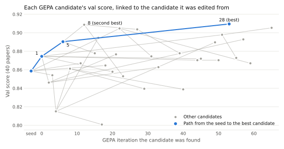

# Prompt evolution for LLM peer review

An experiment in aligning an LLM paper reviewer's scores with those of human reviewers, using GEPA (reflective prompt evolution). The target is the mean overall score that a paper's human ICLR 2026 reviewers gave it.

We start from the reviewer in Sakana AI's [AI Scientist](https://github.com/SakanaAI/AI-Scientist), a documented, prompt-based LLM reviewer, running on a local DeepSeek model (`deepseek-v4-flash-0731`). Its prompt has two parts: a system prompt and a review form that lists the review's fields and rating scales. We call this starting prompt the seed.

We then rewrite the prompt with [GEPA](https://github.com/gepa-ai/gepa). GEPA has the reviewer review a few training papers, then shows the reviews to a second LLM, the reflection model, along with feedback: the reviewer's scores against the human scores, and the weaknesses the human reviewers wrote. The reflection model proposes a revised prompt. GEPA keeps revisions that score better and repeats from them. In our runs the reflection model is the same DeepSeek model.

<picture>
  <source media="(prefers-color-scheme: dark)" srcset="figures/candidate_tree_dark.svg">
  
</picture>

Each dot is one of GEPA's candidate prompts, placed at the iteration it was found and linked to the candidate it was edited from.

## Motivation

LLM reviewers are now used at conference scale. The AAAI-26 AI Review Pilot ([arXiv 2604.13940](https://arxiv.org/abs/2604.13940)) used an LLM reviewer on AAAI-26 submissions and surveyed authors and program committee members about its reviews. Compared with human reviews, they found the AI reviews:
- often failed to judge novelty, significance of contributions, and overall impact;
- overemphasized minor issues and had difficulty prioritizing the significance of issues;
- made factual errors and misread some equations and tables;
- showed shallow understanding of particular research domains.

Our seed also has a problem of its own: it tells the reviewer to be harsh. The AI Scientist system prompt says "Be critical and cautious in your decision. If a paper is bad or you are unsure, give it bad scores and reject it." On our 150 test papers it scores 1.33 points below the human mean on average and gives 2 (reject) to 40% of papers, although only 9% of those papers have a human mean nearest 2.

The reflection model got the four AAAI findings as background. We described them as reports about a different reviewer, asked the model to check them against the feedback, and suggested no fixes.

## Data

Matching human scores only means something if the humans and our reviewer judged the same thing: one version of the paper, scored once. ICLR 2026 comes close. After a [security incident in OpenReview's API](https://blog.iclr.cc/?p=1063) in November 2025, ICLR reverted every review to its state before the rebuttal and discussion, so the public scores are reviewers' first judgment of the submitted paper. We drop the few reviews whose later edits escaped the reversion. OpenReview's PDFs may have been revised since then, so we take each paper's text from its last arXiv version posted before reviews were released (2025-11-12), which is as close as we can get to what reviewers read. We also keep only reviews that Pangram Labs' AI-text detector labels fully human, on papers it judges mostly human-written. The reviews are public under CC BY 4.0, and their score fields match the AI Scientist reviewer's. Counts and matching rules are in `DATASET_CARD.md`.

Only 40% of the papers that pass these filters have a pre-release arXiv version, and they skew toward accepted papers (41% accepted, against 31% of all papers passing the filters). From them we draw:
- 80 train papers. GEPA tries each proposed revision on 6 of them at a time.
- 40 val papers. A revision that beats its parent on those 6 is scored on all 40, and the best val score picks the final prompt.
- 150 locked-test papers, reviewed once with the seed and the final prompt after both were frozen.

Each paper scores 1 − |predicted Overall − human mean Overall| / 10, where Overall is the review's overall rating on ICLR's 0/2/4/6/8/10 scale.

## Early results

GEPA ran for 66 iterations and produced 33 candidate prompts. The run took about 100 hours of compute, serving `deepseek-v4-flash-0731` on two NVIDIA DGX Spark machines, and wrote 1,975 new reviews. We froze the best by val score, candidate 28, and ran it once on the 150 locked-test papers alongside the seed.

| Locked test (150 papers) | Seed | Candidate 28 |
|---|---|---|
| Score | 0.833 | 0.890 |
| Mean signed error (Overall) | −1.33 | −0.49 |
| Mean absolute error (Overall) | 1.61 | 1.10 |
| Pearson with human mean | 0.25 | 0.28 |
| Spearman with human mean | 0.19 | 0.31 |
| Valid reviews | 149 | 150 |

Candidate 28 beats the seed by 0.057 (bootstrap 95% CI [0.036, 0.079]; `runs/locked_test/report.json`), but it scores about the same as guessing 4 for every paper (0.888). Most of the gain comes from removing the seed's harshness. Ranking improves only a little.

### Score distributions

| Overall | Individual human reviews (482) | Human mean, nearest legal score | Seed | Candidate 28 |
|---|---|---|---|---|
| 0 | 0.2% | 0.0% | 0.7% | 0.7% |
| 2 | 22.8% | 9.3% | 40.3% | 8.0% |
| 4 | 35.5% | 56.0% | 53.0% | 74.7% |
| 6 | 27.4% | 29.3% | 5.4% | 16.7% |
| 8 | 13.7% | 5.3% | 0.7% | 0.0% |
| 10 | 0.4% | 0.0% | 0.0% | 0.0% |

Individual human reviewers give 4 only about a third of the time, here and across all 32,716 ICLR 2026 reviews that pass our filters (35%). Averaging about three reviews per paper pulls papers toward the middle, so 56% of papers have a mean nearest 4. Candidate 28 is narrower still. It gives 4 to 75% of papers and never gives 8.

### How the scores moved

Most of candidate 28's extra 4s used to be the seed's 2s. The seed gave 2 to 40% of papers, and candidate 28 moved 48 of those 60 papers up to 4. Their human mean is 4.34, so this one change removes most of the seed's harshness. The table follows each of the 150 papers from its seed score to its candidate 28 score.

| What happened | Papers | Human mean | Closer to humans? |
|---|---|---|---|
| Stayed at 4 | 60 | 4.58 | No change |
| Raised 2 → 4 | 48 | 4.34 | Yes, much closer |
| Raised 4 → 6 | 18 | 5.36 | Slightly closer |
| Stayed at 2 | 11 | 4.42 | No, still far too low |
| Lowered 6 → 4 | 4 | 4.50 | Yes |
| Stayed at 6 | 4 | 6.00 | No change |
| Other single papers | 5 | varies | Mixed |

The final prompt left half the papers' scores unchanged, and almost all of its other changes were also upward. It raised 18 papers from 4 to 6; their human mean is 5.36, so it picked out somewhat stronger papers. It lowered a score in only 6 cases. Eleven papers stayed at 2 although their human mean is 4.42, so its remaining low scores don't identify weaker papers.

## Setup

### Reviewer

Each paper's arXiv PDF is converted to text with MinerU 4.0.12. The text comes from MinerU's standard tier, with figure descriptions from its advanced tier (`intake/mineru.py`). Papers over 75,000 tokens are dropped and replaced by the next paper in the shuffled order: 2 train papers and 2 test papers.

A review is two calls to the model, following the AI Scientist's `perform_review` (`reviewer/review.py`):
1. The system prompt, the review form and the paper. The model writes a THOUGHT section and a review in JSON.
2. The whole conversation plus the AI Scientist's self-critique prompt. The model checks its review and returns a revised one.

The review from the second call is final. If it is missing or lacks a required field, the paper scores 0. GEPA edits only the system prompt and the review form, never the self-critique prompt.

| Setting | Value |
|---|---|
| Model | `deepseek-v4-flash-0731`, 131,072-token context, on two NVIDIA DGX Spark machines |
| Reasoning | On for both calls (`reasoning_effort: "max"`) |
| Sampling | Temperature 1.0, top-p 0.95, seed 42 |
| Output limit | 32,768 tokens per call, reasoning included |
| Empty answers | Retried up to 3 times with the next seed |
| Concurrency | At most 16 requests at once |

These follow the AAAI-26 pilot's settings where possible: reasoning on, one review per paper, and one self-critique round. The seed changes the AI Scientist prompts in one way: the Overall scale is ICLR's 0/2/4/6/8/10 in place of NeurIPS's 1 to 10. (It also fills in a round counter in the self-critique prompt that the original leaves unformatted.)

We checked that the model does not already know the papers (`scripts/contamination_probe.py`). Given only the titles of 30 papers from our splits, it wrote abstracts no closer to the real ones than to unrelated abstracts (word similarity 0.14 against 0.06). It guessed the decision correctly 33% of the time, below the 43% of always guessing the majority decision. For three famous older ICLR papers used as controls, its abstracts reached a similarity of 0.68.

### GEPA

We use GEPA 0.1.4 with its default proposer (`scripts/run_gepa.py`):
- Reflection prompt: GEPA's default template, plus the AAAI background described above.
- Feedback per paper: predicted against human scores on every dimension, the human reviewers' weaknesses (up to 1,500 characters per review), the final review, and its self-critique THOUGHT (up to 3,000 characters).
- Search: minibatches of 6 train papers, a val set of 40, and Pareto candidate selection. Each step edits one of the two prompt parts, in turn.

The budget comes in chunks of 1,000 reviews, and a new chunk starts only if the best val score rose by more than a noise threshold during the last one. The threshold is 0.0341: twice the standard error of the per-paper score difference when the seed reviewed the 40 val papers a second time with a different sampling seed (`scripts/noise_val.py`). That rerun changed the Overall score on 14 of the 40 papers but left the val score unchanged at 0.8587. The run stopped after its second chunk, which improved the best val score by only 0.0008.

The seed and candidate 28 were then frozen, with their hashes, before any test paper was reviewed (`scripts/locked_test.py`). Each test paper was reviewed once with each prompt.

## Seed vs final prompt

The prompts are in `reviewer/seed_candidate.json` and `reviewer/final_candidate.json`.

Candidate 28 is three accepted edits from the seed:
1. The system prompt was rewritten, from 207 to 5,492 characters (candidate 1).
2. The review form was rewritten (candidate 5).
3. The review form was extended to 11,948 characters (candidate 28).

The final prompt is therefore candidate 1's system prompt with candidate 28's review form. The table lists each change that survived into it, next to the goal or the AAAI finding it lines up with. Each pairing is our reading of which input the reflection model was responding to when it made the change.

| Change in the final prompt | Aligned with |
|---|---|
| Calibrate upward. Don't reject because you're unsure. Give Overall 1 to 3 only for a clear fatal flaw. | The optimization goal: make the reviewer's overall score match the mean score from the paper's human ICLR reviewers. The seed scored much lower than the humans. |
| "LLM reviewers … over-score." Don't default to 6, and give 6 only when weaknesses are minor. | The optimization goal: match the human mean score. This corrects the overshoot from the first edit. |
| Overall must be 0/2/4/6/8/10, with no 5. Decision follows from Overall. | Producing a valid review on ICLR's scale. It fixes a conflict between the two prompt parts, and nothing in the background we supplied mentions it. |
| Re-derive equations before claiming an error. If unsure, ask a question. State exactly why something is wrong. | AAAI-26 pilot finding: the LLM reviewer "made factual errors and misread some equations and tables." |
| Rank weaknesses by importance. Put typos in Questions. Don't let minor issues dominate. | AAAI-26 pilot finding: the LLM reviewer "overemphasized minor issues and had difficulty prioritizing the significance of issues." |
| Judge novelty and significance explicitly. Name standard frameworks. Don't call a paper "incremental" without a concrete prior work. Benchmarks and negative results count. | AAAI-26 pilot finding: the LLM reviewer "often failed to judge novelty, significance of contributions, and overall impact." |
| Use the subfield's standard baselines. Say when a method is a standard technique. | AAAI-26 pilot finding: the LLM reviewer "showed shallow understanding of particular research domains." |
| Domain rules (theory, empirical, dataset, agent, safety, unlearning, causal ML, LLM-as-judge, plus six topic reminders) | The same AAAI-26 finding on shallow domain understanding, in spirit. The specific rules restate concerns that human reviewers raised about individual training papers. |
| Empirical checklist: same protocol, joint vs separate training, misleading metrics, significance tests, test-set leakage | Partly the AAAI-26 finding on factual errors. Mostly concerns from human reviewers and the reviewer's own self-critiques on individual training papers. |
| Acknowledge strengths such as code release and broad experiments | Matching the human mean score: the seed listed weaknesses and skipped strengths, which pulled its scores down. No AAAI-26 finding covers this. |
| "Experienced area chair: not overly generous, not nitpicky" framing | Matching the human mean score (neither too generous nor too harsh), and the AAAI-26 finding that the LLM reviewer "overemphasized minor issues." |
| Restructured form: headings, a ratings block, explicit JSON keys, scales for Originality, Quality, Clarity and Significance | Nothing we supplied. It's a formatting change. |
| Full JSON schema in the system prompt with Overall 1 to 10 and a "Borderline" decision | Nothing we supplied. It conflicts with the review form's even-only scale and binary decision (but none of the 150 locked-test reviews used an illegal score or decision). |

## Limitations

- **The score mostly rewards calibration.** Guessing 4 for every test paper scores 0.888, against candidate 28's 0.890. Candidate 28 gives 4 to 75% of papers. Its gain over the seed comes mainly from removing the seed's harshness, and its ranking improves only a little (Pearson 0.25 to 0.28).
- **The selection is noisy.** This is one GEPA run with one review per paper and 40 val papers. The noise threshold (0.0341) is far larger than the gap between the two best candidates (0.0008). The second best, candidate 8, came at iteration 12 and candidate 28 at iteration 53, so the 41 iterations between them moved the best val score by less than the noise.
- **The scorer accepted off-scale scores.** A 5 counted as a valid review, although ICLR's scale has no 5. Candidate 8 used it on 5 of 40 val papers.
- **Some domain rules are specific to training papers.** Many of the final prompt's domain rules restate concerns about single training papers, such as unlearning, causal ML and LLM-as-judge. They help only where a test paper raises the same issue.
- **The two prompt parts describe different scales, but this doesn't show in the output.** The system prompt (last edited in GEPA's first step) still describes a 1 to 10 Overall scale with a "Borderline" decision. The review form allows only 0/2/4/6/8/10 and Accept/Reject. We checked all 150 locked-test reviews and the 51 reviews made during the run, in both passes. Every one used a legal Overall value and Accept or Reject, and the decision always matched the score.
- **Some first-pass reviews were stored without scores.** The system prompt says "Return only the JSON object", so some first passes skip the review form's fenced format. The parser we took from the AI Scientist then falls back to a pattern that stops at the first `}`. As a result, 24 of 150 locked-test first passes are stored without scores, though 21 of them were valid JSON. Results are unaffected: the self-critique sees the raw reply, and all scores come from the second pass, which parsed every time.
- **The same model reviews and reflects.** We have not tried a different reflection model.
- **The data has known gaps.** The arXiv version is close to, but not guaranteed to be, the version reviewers read. Requiring one skews the set toward accepted papers. A mean of about three human reviews is itself a noisy target: individual ratings on one paper ranged from 2 to 8.

## Reproducing

Prerequisites:
- Python 3.14 and `pip install -r requirements.txt`.
- An OpenAI-compatible server for `deepseek-v4-flash-0731`. Set its address as the `BASE_URL` environment variable (default `http://localhost:8000/v1`).
- The DeepSeek-V3 `tokenizer.json` at `data/tokenizers/deepseek-v3_tokenizer.json`, used to count tokens.
- The AI Scientist at commit `1de1dbc1` in `third_party/AI-Scientist`. The seed prompts are read from its `ai_scientist/perform_review.py`.
- An OpenReview account, set as `OPENREVIEW_USERNAME` and `OPENREVIEW_PASSWORD` in `.env`. The API refuses guest access.
- Pangram's ICLR 2026 JSON files from iclr.pangram.com, saved to `data/raw/pangram/`. The site needs a browser.
- A MinerU 4.0.12 environment. Set `MINERU_KIT` to its `mineru-kit` binary (default: `mineru-kit` on `PATH`) and, if needed, `MINERU_HOME` to its model cache.

Steps, in order:

| Step | Command | Output |
|---|---|---|
| Pull ICLR 2026 from OpenReview | `scripts/pull_iclr2026.py` | `data/raw/iclr2026/` |
| Parse papers and reviews | `scripts/parse_iclr2026.py` | `data/derived/`, `data/frame/all_ids.txt` |
| Flag reviews edited after release | `scripts/freeze_check.py` | `data/derived/post_freeze_reviews.csv` |
| Filter to eligible papers | `scripts/build_eligible.py`, then `scripts/pangram_tables.py` | `data/frame/eligible_ids.txt` |
| Shuffle once (seed 42) | `scripts/draw_slices.py` | `data/frame/slices.json` |
| Find and download arXiv versions | `scripts/run_arxiv_pipeline.sh` | `data/pdf/iclr2026/` |
| Convert PDFs | `scripts/run_mineru.sh` | `data/mineru/`, `data/mineru_adv/` |
| Cut the train, val and test slices | `scripts/draw_slices_pdf.py` | `data/frame/slices_pdf.json` |
| Review train and val with the seed | `scripts/baseline_watch.py` | `runs/baseline/` |
| Measure the noise threshold | `scripts/noise_val.py` | `runs/noise_val/`, prints the threshold |
| Run GEPA | `scripts/run_gepa.py` (`--check`, then `--smoke`, then no flag) | `runs/gepa/main/` |
| Review the locked test | `scripts/locked_test.py` | `runs/locked_test/report.json` |
| Plot the candidate tree | `scripts/plot_candidate_tree.py` | `figures/` |

Run each script with `.venv/bin/python`. Every step resumes where it stopped. `draw_slices.py` refuses to redraw. A rerun may not match ours exactly, because arXiv, OpenReview and Pangram may have changed since we pulled them.

Data details are in `DATASET_CARD.md`.
